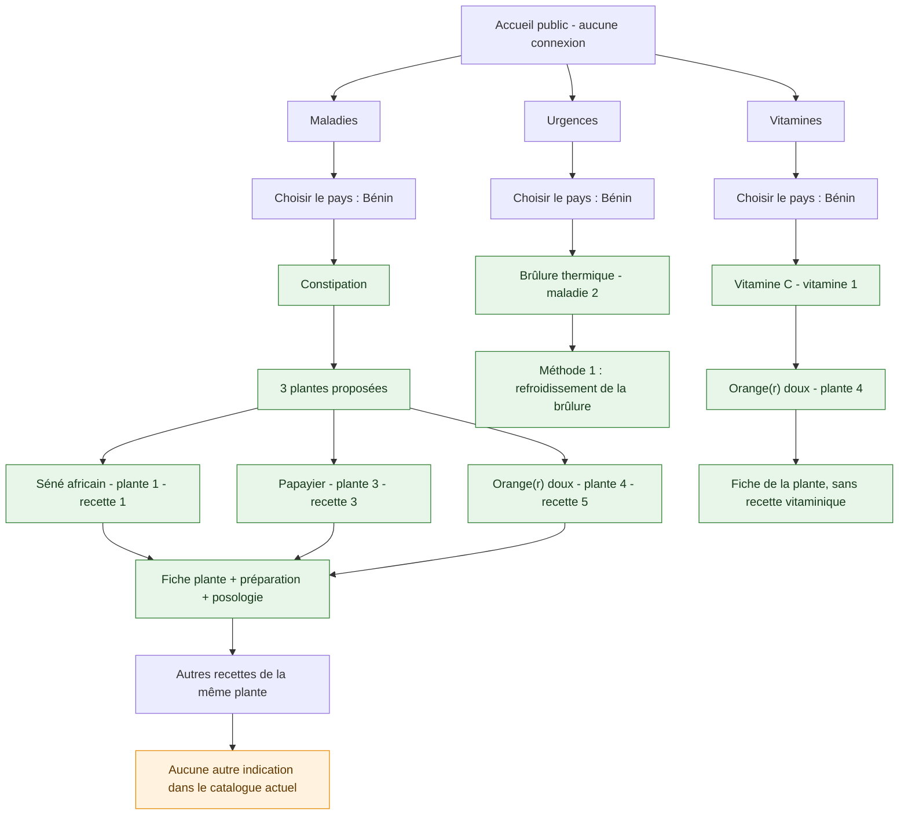
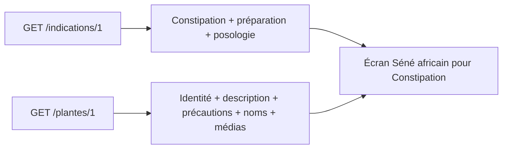
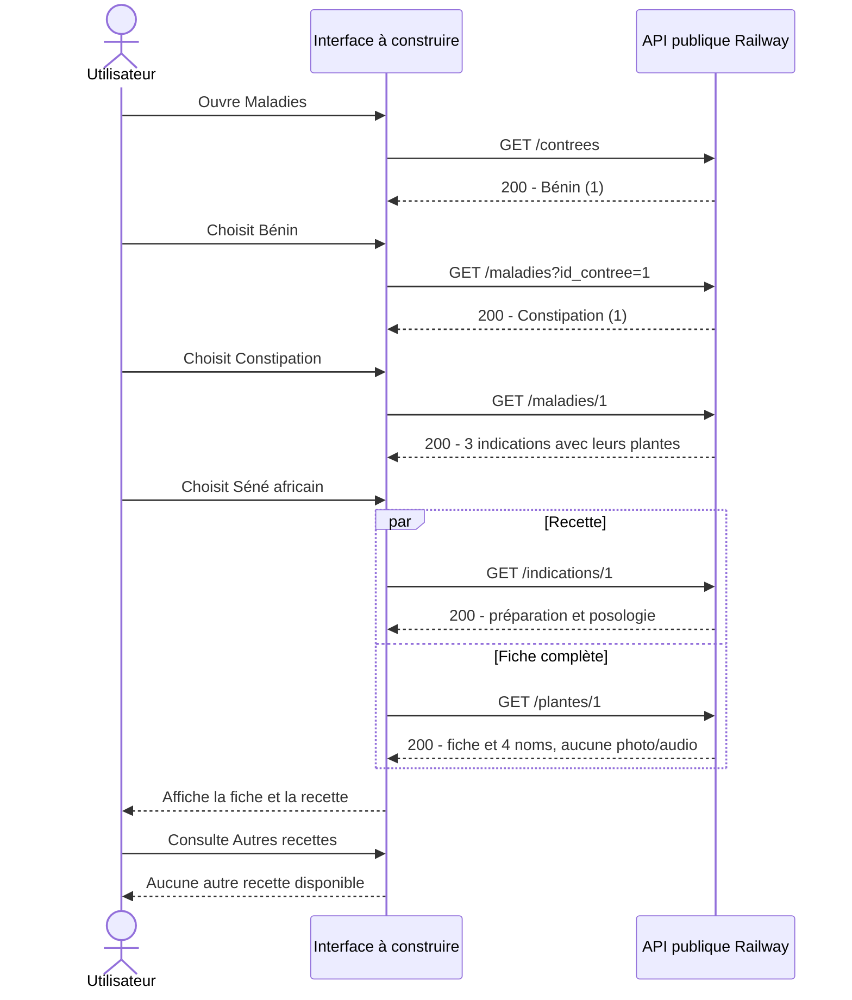

# Afro Mansin - Parcours utilisateur illustré avec les données de production

Ce document montre ce qu’un utilisateur peut consulter avec le catalogue actuel. Les écrans et boutons ci-dessous illustrent la future interface ; les données proviennent de réponses réelles de l’API publique, pas d’un frontend déjà livré.

- Relevé : 18 octobre 2026, heure de référence Africa/Porto-Novo.
- Base : https://phytot-rapie-app-backend-production.up.railway.app
- Accès : GET publics uniquement, aucun compte ni token nécessaire.
- Aucune donnée modifiée, aucun appel aux comptes admin ou au suivi.
- Mise à jour : ajout en production d’une urgence, d’une méthode et de la vitamine C avec sa plante source. Les réponses initiales en annexe restent un relevé historique ; les réponses complémentaires sont dans la dernière section.
- Les IDs et les quantités représentent ces relevés et peuvent évoluer.
- Les textes de préparation, de posologie et de précautions sont reproduits depuis l’API pour illustrer l’affichage ; leur présence ne constitue pas une validation médicale du contenu.

Pour visualiser les graphiques, ouvrir l’aperçu Markdown dans un éditeur prenant en charge Mermaid. Les diagrammes sont accompagnés de tableaux pour garder une lecture possible sans rendu graphique. Référence technique complémentaire : [guide API client](api-client.md).

## Sommaire

1. [Vue générale](#vue-générale)
2. [Ce qui est disponible](#ce-qui-est-disponible)
3. [Parcours écran par écran](#parcours-écran-par-écran)
4. [Les trois fiches consultables](#les-trois-fiches-consultables)
5. [Parcours Urgences et Vitamines](#parcours-urgences-et-vitamines)
6. [Échanges entre interface et API](#échanges-entre-interface-et-api)
7. [Comportements à prévoir dans l’interface](#comportements-à-prévoir-dans-linterface)
8. [Annexe - réponses publiques relevées](#annexe---réponses-publiques-relevées)

## Vue générale



Les trois rubriques sont alimentées : **Maladies > Bénin > Constipation > plante et recette**, **Urgences > Bénin > Brûlure thermique > méthode**, et **Vitamines > Bénin > Vitamine C > oranger**.

## Ce qui est disponible

| Élément | Quantité réellement renvoyée | Détail |
|---|---|---|
| Pays | 1 | Bénin, ID 1 |
| Maladies | 2 | Constipation, ID 1 ; Brûlure thermique, ID 2, est_urgence=true |
| Plantes | 3 | Séné africain, Papayier, Orange(r) doux |
| Recettes / indications | 3 | Une par plante pour la constipation |
| Langues | 5 | Français, Anglais, Fon, Yoruba, Goun |
| Noms dans les langues | 10 | 4 pour le séné, 3 pour le papayer, 3 pour l’oranger |
| Photos | 0 | Aucune URL image |
| Vitamines | 1 | Vitamine C, ID 1 |
| Méthodes non végétales | 1 | Refroidissement d’une brûlure thermique, ID 1 |
| Associations vitamine/plante | 1 | Vitamine 1 / oranger 4 |
| Associations maladie/méthode | 1 | Brûlure 2 / méthode 1 |

Les 10 noms ont tous `audio_url: null`. Goun existe dans le référentiel, mais aucune des trois plantes n’a de nom Goun renseigné.

## Parcours écran par écran

### Écran 1 - Accueil

L’utilisateur voit trois entrées : **Maladies**, **Urgences**, **Vitamines**. Il choisit par exemple Maladies. Aucun formulaire de connexion n’intervient.

### Écran 2 - Choix du pays

[`GET /contrees`](https://phytot-rapie-app-backend-production.up.railway.app/contrees) renvoie :

```json
[{"id_contree":1,"nom":"Bénin"}]
```

Afficher **Bénin**, puis conserver `id_contree=1` dans la navigation. Le pays est le contexte du catalogue ; il ne représente pas une géolocalisation de l’utilisateur.

### Écran 3 - Choix de la maladie

[`GET /maladies?id_contree=1`](https://phytot-rapie-app-backend-production.up.railway.app/maladies?id_contree=1) renvoyait, avant l’ajout de l’urgence :

```json
[
  {
    "id_maladie": 1,
    "nom": "Constipation",
    "est_urgence": false,
    "regles_hygiene": null,
    "id_contree": 1
  }
]
```

La réponse actuelle contient également **Brûlure thermique**, avec `est_urgence=true`. Dans la rubrique Maladies, afficher **Constipation** après filtrage et conserver `id_maladie=1`. Pour l’écran des maladies ordinaires, garder uniquement les réponses où `est_urgence === false` côté interface : le filtre serveur `?est_urgence=false` convertit actuellement la chaîne en true.

### Écran 4 - Choix d’une plante pour la constipation

[`GET /maladies/1`](https://phytot-rapie-app-backend-production.up.railway.app/maladies/1) contient `contree`, `indications[].plante` et `indications_methode`. Pour cette maladie, les trois indications sont :

| Choix affiché | Nom scientifique | ID plante | ID recette | Action |
|---|---|---|---|---|
| Séné africain | Cassia italica | 1 | 1 | Ouvrir la fiche et cette recette |
| Papayier | Carica papaya | 3 | 3 | Ouvrir la fiche et cette recette |
| Orange(r) doux | Citrus sinensis | 4 | 5 | Ouvrir la fiche et cette recette |

`regles_hygiene` est null : aucun texte de règles générales n’est disponible. `indications_methode` est vide : aucune méthode alternative n’est associée à cette maladie.

### Écran 5 - Fiche de la plante et recette choisie

Deux données sont réunies pour construire l’écran :

- `GET /indications/:id` donne la recette choisie, sa maladie et sa plante sans médias imbriqués.
- `GET /plantes/:id` donne la fiche complète avec `photos`, `noms_locaux[].langue` et `indications[].maladie`.

Exemple pour le séné : **GET /indications/1 + GET /plantes/1**. La description appartient à la plante, tandis que la préparation et la posologie appartiennent à l’indication.



### Écran 6 - Autres recettes

Le bouton peut exploiter `GET /plantes/:id` et son tableau `indications`, puis exclure l’indication actuellement consultée. Une autre possibilité est `GET /indications?id_plante=:id`.

Dans cet instantané, chaque plante a une seule indication, celle de la constipation. Après exclusion de la recette courante, le résultat est donc vide : afficher **« Aucune autre recette disponible pour cette plante »** ou masquer le bouton. Si d’autres pays sont ajoutés, filtrer aussi sur `maladie.id_contree` pour conserver le contexte Bénin.

## Les trois fiches consultables

Les contenus ci-dessous reprennent les valeurs de production. Seuls les retours à la ligne sont adaptés à la présentation.

### Séné africain - Cassia italica

Navigation : **Maladies > Bénin > Constipation > Séné africain**.

Fiche : [`GET /plantes/1`](https://phytot-rapie-app-backend-production.up.railway.app/plantes/1). Recette : [`GET /indications/1`](https://phytot-rapie-app-backend-production.up.railway.app/indications/1).

| Donnée de la fiche | Contenu renvoyé |
|---|---|
| Nom français | Séné africain |
| Nom scientifique | Cassia italica |
| Famille | Non renseigné |
| Description | C'est un petit arbuste dépassant rarement 50 cm de haut. Les<br>feuilles sont composées pennées, les fruits sont des gousses<br>plates et arrondies. |
| Répartition | Régions sèches d'Afrique |
| Reconnaissance / astuces | Non renseigné |
| Partie utile | Tige feuillées sans les gousses |
| Contre-indications | Femme enceinte ou Allaitement, |
| Effets indésirables connus | Diarrhées, douleurs gastriques, colique |
| Mise en garde spéciale | Pas d'usage à long terme |
| Référence | PLANTES MEDICINALES<br>AFRICAINES, Jean-Louis POUSSET |

**Noms disponibles**

| Langue | Nom ou variantes | Audio |
|---|---|---|
| Français | Séné africain | Non renseigné |
| Anglais | Senegal<br>Tripoli<br>Italian<br>Jamaica<br>Port Royal senna | Non renseigné |
| Fon | Agwema<br>Agouègbé<br>Amasu Agweton<br>Gunuton | Non renseigné |
| Yoruba | Filasko | Non renseigné |

**Recette pour la constipation**

| Donnée de la recette | Contenu renvoyé |
|---|---|
| Méthode de préparation | Verser un litre d'eau chaude sur 20 grammes de feuilles,<br>laisser infuser une demi heure et boire un grand verre<br>avant de se coucher. |
| Posologie | Boire un grand verre avant de se coucher |
| Règles hygiéno-diététiques | Non renseigné |

Photos : **0**. Autres indications après exclusion de la recette actuelle : **0**.

### Papayier - Carica papaya

Navigation : **Maladies > Bénin > Constipation > Papayier**.

Fiche : [`GET /plantes/3`](https://phytot-rapie-app-backend-production.up.railway.app/plantes/3). Recette : [`GET /indications/3`](https://phytot-rapie-app-backend-production.up.railway.app/indications/3).

| Donnée de la fiche | Contenu renvoyé |
|---|---|
| Nom français | Papayier |
| Nom scientifique | Carica papaya |
| Famille | Non renseigné |
| Description | Arbrisseau à croissance très<br>rapide, à feuilles découpées, à fleurs jaunes<br>et à grands fruits (papayes) jaune-orangé<br>à graines noires (8 m de haut) |
| Répartition | la papaye est cultivée<br>dans toutes les régions tropicales. |
| Reconnaissance / astuces | Non renseigné |
| Partie utile | Non renseigné |
| Contre-indications | Non renseigné |
| Effets indésirables connus | Non renseigné |
| Mise en garde spéciale | Non renseigné |
| Référence | Non renseigné |

**Noms disponibles**

| Langue | Nom ou variantes | Audio |
|---|---|---|
| Français | Papayier | Non renseigné |
| Anglais | papaya | Non renseigné |
| Fon | Kpenti | Non renseigné |

**Recette pour la constipation**

| Donnée de la recette | Contenu renvoyé |
|---|---|
| Méthode de préparation | Laver correctement le fruit vert ou mur et enlever ou non la peau Faire du jus de papaye avec le fruit bien mùr |
| Posologie | Mangez 4 ou 5 tranches de papaye crue ou bien mur après le petit-déjeuner et le diner Boire le jus de papaye après le petit-dejeuner et le diner |
| Règles hygiéno-diététiques | Non renseigné |

Photos : **0**. Autres indications après exclusion de la recette actuelle : **0**.

### Orange(r) doux - Citrus sinensis

Navigation : **Maladies > Bénin > Constipation > Orange(r) doux**.

Fiche : [`GET /plantes/4`](https://phytot-rapie-app-backend-production.up.railway.app/plantes/4). Recette : [`GET /indications/5`](https://phytot-rapie-app-backend-production.up.railway.app/indications/5).

| Donnée de la fiche | Contenu renvoyé |
|---|---|
| Nom français | Orange(r) doux |
| Nom scientifique | Citrus sinensis |
| Famille | Non renseigné |
| Description | Arbre à feuilles persistantes<br>vert foncé, à fleurs blanches parfumées et à<br>fruits orange (10 m de haut). |
| Répartition | Originaire<br>des régions tropicales d'Asie, cet arbre estcultivé dans toutes les zones tropicales<br>et subtropicales. |
| Reconnaissance / astuces | Non renseigné |
| Partie utile | Non renseigné |
| Contre-indications | Non renseigné |
| Effets indésirables connus | Non renseigné |
| Mise en garde spéciale | ATTENTION Ne pas absorber les huiles<br>essentielles sans contrôle médical si l'on en consomme trop, son<br>acidité favorise l'arthrite |
| Référence | Larousse des plantes medecinales |

**Noms disponibles**

| Langue | Nom ou variantes | Audio |
|---|---|---|
| Français | Orange(r) doux | Non renseigné |
| Anglais | sweet orange | Non renseigné |
| Fon | yovozin | Non renseigné |

**Recette pour la constipation**

| Donnée de la recette | Contenu renvoyé |
|---|---|
| Méthode de préparation | Laver correctement le fruit et enlever la peau ( on obtient le fruit sans le zeste ) |
| Posologie | consommer le fruit ( sans zeste ) sauf les pépins ,<br>très acide et amer il facilite la<br>digestion et soulage les flatulences |
| Règles hygiéno-diététiques | Non renseigné |

Photos : **0**. Autres indications après exclusion de la recette actuelle : **0**.

## Parcours Urgences et Vitamines

### Urgences - Brûlure thermique

**Accueil > Urgences > Bénin > Brûlure thermique > Refroidissement d’une brûlure thermique.**

| Étape | GET public | Résultat vérifié |
|---|---|---|
| Liste des urgences | `/maladies?id_contree=1&est_urgence=true` | Brûlure thermique, ID 2 |
| Détail de l’urgence | `/maladies/2` | Une méthode associée, aucune recette de plante |
| Instructions spécifiques | `/indications-methode/2/1` | Association maladie 2 / méthode 1 et description |
| Fiche générale de la méthode | `/methodes/1` | Description et urgence associée |


Le texte enregistré indique le refroidissement à l’eau courante fraîche pendant 20 minutes et les situations nécessitant une aide médicale urgente. Aucun remède végétal n’a été associé à cette brûlure. Source utilisée : [NHS - Burns and scalds](https://www.nhs.uk/conditions/burns-and-scalds/). La méthode contient le lien source et les précautions, sans reprendre de numéro d’urgence britannique pour le Bénin.

### Vitamines - Vitamine C

**Accueil > Vitamines > Bénin > Vitamine C > Orange(r) doux > Fiche plante.**

| Étape | GET public | Résultat vérifié |
|---|---|---|
| Liste des vitamines | `/vitamines?id_contree=1` | Vitamine C, ID 1 |
| Détail et sources | `/vitamines/1` | Une source : Orange(r) doux / Citrus sinensis, plante 4 |
| Association exacte | `/sources-vitamine/1/4` | Vitamine 1 liée à la plante 4 |
| Fiche avec noms locaux | `/plantes/4` | Noms français, anglais et Fon ; aucun média |


La relation vitamine C/orange s’appuie sur [NIH ODS - Vitamin C](https://ods.od.nih.gov/factsheets/VitaminC/Consumer/). La relation ne comporte pas de champ référence : la source est conservée dans cette documentation. Aucune quantité, préparation ni posologie vitaminique n’a été ajoutée. L’oranger conserve par ailleurs sa recette contre la constipation ; celle-ci ne doit pas être présentée comme une recette de vitamine C.

## Échanges entre interface et API



Les appels recette/plante peuvent être parallélisés une fois leurs IDs connus depuis l’écran précédent. L’interface peut aussi réutiliser une recette déjà reçue dans la réponse de la maladie ; aucun nouvel appel n’est obligatoire si les données sont en mémoire.

## Comportements à prévoir dans l’interface

| Situation réelle ou possible | Affichage / action |
|---|---|
| Liste vide avec HTTP 200 | État vide compréhensible, pas une erreur serveur |
| Photo absente | Emplacement neutre ou galerie masquée ; aucune photo inventée |
| audio_url=null | Aucun bouton de lecture actif |
| Nom absent dans une langue | Ne pas inventer de traduction ; Goun est actuellement absent des trois fiches |
| Plusieurs variantes dans un nom | Préserver leurs séparations ; une seule association plante/langue |
| Précautions nulles | « Non renseigné », sans affirmer l’absence de risque |
| Famille, partie utile ou référence absente | Masquer le champ ou indiquer « Non renseigné » |
| Aucune autre indication | Masquer le bouton ou montrer l’état vide |
| Identifiant devenu introuvable, HTTP 404 | Ressource indisponible, proposer le retour à la liste |
| Erreur réseau ou HTTP 5xx | Message temporaire et possibilité de réessayer |
| Recherche saisie | Filtrage local des listes chargées ; pas de recherche serveur implémentée |

L’avertissement général de la maquette reste à afficher par l’interface : « Les conseils contenus dans cette application ne représentent aucunement une consultation médicale et ne peuvent pas se substituer à elle. » Il n’est pas fourni comme champ global par ces réponses.

Le parcours s’arrête à la consultation du contenu et aux retours de navigation. Le suivi à 48 h reste reporté.

## Annexe - réponses publiques relevées

Ces blocs conservent les sorties JSON exactes du relevé initial, avant l’ajout Urgences/Vitamines. Les listes vides et la liste des maladies ci-dessous sont donc historiques. Pour les nouveaux parcours, consulter la dernière section et les endpoints en direct. Les détails volumineux sont repliables dans les lecteurs Markdown qui prennent en charge les balises HTML `details`.

<details>
<summary>GET /health - HTTP 200</summary>

[Ouvrir cet endpoint](https://phytot-rapie-app-backend-production.up.railway.app/health)

```json
{
  "status": "ok",
  "service": "afro-mansin-api"
}
```

</details>

<details>
<summary>GET /contrees - HTTP 200</summary>

[Ouvrir cet endpoint](https://phytot-rapie-app-backend-production.up.railway.app/contrees)

```json
[
  {
    "id_contree": 1,
    "nom": "Bénin"
  }
]
```

</details>

<details>
<summary>GET /langues - HTTP 200</summary>

[Ouvrir cet endpoint](https://phytot-rapie-app-backend-production.up.railway.app/langues)

```json
[
  {
    "id_langue": 3,
    "nom": "Anglais"
  },
  {
    "id_langue": 4,
    "nom": "Fon"
  },
  {
    "id_langue": 1,
    "nom": "Français"
  },
  {
    "id_langue": 6,
    "nom": "Goun"
  },
  {
    "id_langue": 5,
    "nom": "Yoruba"
  }
]
```

</details>

<details>
<summary>GET /plantes - HTTP 200</summary>

[Ouvrir cet endpoint](https://phytot-rapie-app-backend-production.up.railway.app/plantes)

```json
[
  {
    "id_plante": 4,
    "nom_francais": "Orange(r) doux",
    "nom_scientifique": "Citrus sinensis",
    "famille": null,
    "description": "Arbre à feuilles persistantes\nvert foncé, à fleurs blanches parfumées et à\nfruits orange (10 m de haut).",
    "repartition": "Originaire\ndes régions tropicales d'Asie, cet arbre estcultivé dans toutes les zones tropicales\net subtropicales.",
    "reconnaissance_astuces": null,
    "partie_utile": null,
    "contre_indications": null,
    "effets_indesirables_connus": null,
    "mise_en_garde_speciale": "ATTENTION Ne pas absorber les huiles\nessentielles sans contrôle médical si l'on en consomme trop, son\nacidité favorise l'arthrite",
    "reference_bibliographique": "Larousse des plantes medecinales",
    "photos": [],
    "noms_locaux": [
      {
        "id_plante": 4,
        "id_langue": 1,
        "nom_local": "Orange(r) doux",
        "audio_url": null,
        "langue": {
          "id_langue": 1,
          "nom": "Français"
        }
      },
      {
        "id_plante": 4,
        "id_langue": 3,
        "nom_local": "sweet orange",
        "audio_url": null,
        "langue": {
          "id_langue": 3,
          "nom": "Anglais"
        }
      },
      {
        "id_plante": 4,
        "id_langue": 4,
        "nom_local": "yovozin",
        "audio_url": null,
        "langue": {
          "id_langue": 4,
          "nom": "Fon"
        }
      }
    ]
  },
  {
    "id_plante": 3,
    "nom_francais": "Papayier",
    "nom_scientifique": "Carica papaya",
    "famille": null,
    "description": "Arbrisseau à croissance très\nrapide, à feuilles découpées, à fleurs jaunes\net à grands fruits (papayes) jaune-orangé\nà graines noires (8 m de haut)",
    "repartition": "la papaye est cultivée\ndans toutes les régions tropicales.",
    "reconnaissance_astuces": null,
    "partie_utile": null,
    "contre_indications": null,
    "effets_indesirables_connus": null,
    "mise_en_garde_speciale": null,
    "reference_bibliographique": null,
    "photos": [],
    "noms_locaux": [
      {
        "id_plante": 3,
        "id_langue": 1,
        "nom_local": "Papayier",
        "audio_url": null,
        "langue": {
          "id_langue": 1,
          "nom": "Français"
        }
      },
      {
        "id_plante": 3,
        "id_langue": 3,
        "nom_local": "papaya",
        "audio_url": null,
        "langue": {
          "id_langue": 3,
          "nom": "Anglais"
        }
      },
      {
        "id_plante": 3,
        "id_langue": 4,
        "nom_local": "Kpenti",
        "audio_url": null,
        "langue": {
          "id_langue": 4,
          "nom": "Fon"
        }
      }
    ]
  },
  {
    "id_plante": 1,
    "nom_francais": "Séné africain",
    "nom_scientifique": "Cassia italica",
    "famille": null,
    "description": "C'est un petit arbuste dépassant rarement 50 cm de haut. Les\nfeuilles sont composées pennées, les fruits sont des gousses\nplates et arrondies.",
    "repartition": "Régions sèches d'Afrique",
    "reconnaissance_astuces": null,
    "partie_utile": "Tige feuillées sans les gousses",
    "contre_indications": "Femme enceinte ou Allaitement,",
    "effets_indesirables_connus": "Diarrhées, douleurs gastriques, colique",
    "mise_en_garde_speciale": "Pas d'usage à long terme",
    "reference_bibliographique": "PLANTES MEDICINALES\nAFRICAINES, Jean-Louis POUSSET",
    "photos": [],
    "noms_locaux": [
      {
        "id_plante": 1,
        "id_langue": 1,
        "nom_local": "Séné africain",
        "audio_url": null,
        "langue": {
          "id_langue": 1,
          "nom": "Français"
        }
      },
      {
        "id_plante": 1,
        "id_langue": 3,
        "nom_local": "Senegal\nTripoli\nItalian\nJamaica\nPort Royal senna",
        "audio_url": null,
        "langue": {
          "id_langue": 3,
          "nom": "Anglais"
        }
      },
      {
        "id_plante": 1,
        "id_langue": 4,
        "nom_local": "Agwema\nAgouègbé\nAmasu Agweton\nGunuton",
        "audio_url": null,
        "langue": {
          "id_langue": 4,
          "nom": "Fon"
        }
      },
      {
        "id_plante": 1,
        "id_langue": 5,
        "nom_local": "Filasko",
        "audio_url": null,
        "langue": {
          "id_langue": 5,
          "nom": "Yoruba"
        }
      }
    ]
  }
]
```

</details>

<details>
<summary>GET /maladies - HTTP 200</summary>

[Ouvrir cet endpoint](https://phytot-rapie-app-backend-production.up.railway.app/maladies)

```json
[
  {
    "id_maladie": 1,
    "nom": "Constipation",
    "est_urgence": false,
    "regles_hygiene": null,
    "id_contree": 1
  }
]
```

</details>

<details>
<summary>GET /vitamines - HTTP 200</summary>

[Ouvrir cet endpoint](https://phytot-rapie-app-backend-production.up.railway.app/vitamines)

```json
[]
```

</details>

<details>
<summary>GET /methodes - HTTP 200</summary>

[Ouvrir cet endpoint](https://phytot-rapie-app-backend-production.up.railway.app/methodes)

```json
[]
```

</details>

<details>
<summary>GET /indications - HTTP 200</summary>

[Ouvrir cet endpoint](https://phytot-rapie-app-backend-production.up.railway.app/indications)

```json
[
  {
    "id_indication": 1,
    "id_maladie": 1,
    "id_plante": 1,
    "methode_preparation": "Verser un litre d'eau chaude sur 20 grammes de feuilles,\nlaisser infuser une demi heure et boire un grand verre\navant de se coucher.",
    "posologie": "Boire un grand verre avant de se coucher",
    "regles_hygieno_diet": null,
    "maladie": {
      "id_maladie": 1,
      "nom": "Constipation",
      "est_urgence": false,
      "regles_hygiene": null,
      "id_contree": 1
    },
    "plante": {
      "id_plante": 1,
      "nom_francais": "Séné africain",
      "nom_scientifique": "Cassia italica",
      "famille": null,
      "description": "C'est un petit arbuste dépassant rarement 50 cm de haut. Les\nfeuilles sont composées pennées, les fruits sont des gousses\nplates et arrondies.",
      "repartition": "Régions sèches d'Afrique",
      "reconnaissance_astuces": null,
      "partie_utile": "Tige feuillées sans les gousses",
      "contre_indications": "Femme enceinte ou Allaitement,",
      "effets_indesirables_connus": "Diarrhées, douleurs gastriques, colique",
      "mise_en_garde_speciale": "Pas d'usage à long terme",
      "reference_bibliographique": "PLANTES MEDICINALES\nAFRICAINES, Jean-Louis POUSSET"
    }
  },
  {
    "id_indication": 3,
    "id_maladie": 1,
    "id_plante": 3,
    "methode_preparation": "Laver correctement le fruit vert ou mur et enlever ou non la peau Faire du jus de papaye avec le fruit bien mùr",
    "posologie": "Mangez 4 ou 5 tranches de papaye crue ou bien mur après le petit-déjeuner et le diner Boire le jus de papaye après le petit-dejeuner et le diner",
    "regles_hygieno_diet": null,
    "maladie": {
      "id_maladie": 1,
      "nom": "Constipation",
      "est_urgence": false,
      "regles_hygiene": null,
      "id_contree": 1
    },
    "plante": {
      "id_plante": 3,
      "nom_francais": "Papayier",
      "nom_scientifique": "Carica papaya",
      "famille": null,
      "description": "Arbrisseau à croissance très\nrapide, à feuilles découpées, à fleurs jaunes\net à grands fruits (papayes) jaune-orangé\nà graines noires (8 m de haut)",
      "repartition": "la papaye est cultivée\ndans toutes les régions tropicales.",
      "reconnaissance_astuces": null,
      "partie_utile": null,
      "contre_indications": null,
      "effets_indesirables_connus": null,
      "mise_en_garde_speciale": null,
      "reference_bibliographique": null
    }
  },
  {
    "id_indication": 5,
    "id_maladie": 1,
    "id_plante": 4,
    "methode_preparation": "Laver correctement le fruit et enlever la peau ( on obtient le fruit sans le zeste )",
    "posologie": "consommer le fruit ( sans zeste ) sauf les pépins ,\ntrès acide et amer il facilite la\ndigestion et soulage les flatulences",
    "regles_hygieno_diet": null,
    "maladie": {
      "id_maladie": 1,
      "nom": "Constipation",
      "est_urgence": false,
      "regles_hygiene": null,
      "id_contree": 1
    },
    "plante": {
      "id_plante": 4,
      "nom_francais": "Orange(r) doux",
      "nom_scientifique": "Citrus sinensis",
      "famille": null,
      "description": "Arbre à feuilles persistantes\nvert foncé, à fleurs blanches parfumées et à\nfruits orange (10 m de haut).",
      "repartition": "Originaire\ndes régions tropicales d'Asie, cet arbre estcultivé dans toutes les zones tropicales\net subtropicales.",
      "reconnaissance_astuces": null,
      "partie_utile": null,
      "contre_indications": null,
      "effets_indesirables_connus": null,
      "mise_en_garde_speciale": "ATTENTION Ne pas absorber les huiles\nessentielles sans contrôle médical si l'on en consomme trop, son\nacidité favorise l'arthrite",
      "reference_bibliographique": "Larousse des plantes medecinales"
    }
  }
]
```

</details>

<details>
<summary>GET /indications-methode - HTTP 200</summary>

[Ouvrir cet endpoint](https://phytot-rapie-app-backend-production.up.railway.app/indications-methode)

```json
[]
```

</details>

<details>
<summary>GET /sources-vitamine - HTTP 200</summary>

[Ouvrir cet endpoint](https://phytot-rapie-app-backend-production.up.railway.app/sources-vitamine)

```json
[]
```

</details>

<details>
<summary>GET /noms-locaux - HTTP 200</summary>

[Ouvrir cet endpoint](https://phytot-rapie-app-backend-production.up.railway.app/noms-locaux)

```json
[
  {
    "id_plante": 1,
    "id_langue": 1,
    "nom_local": "Séné africain",
    "audio_url": null,
    "langue": {
      "id_langue": 1,
      "nom": "Français"
    }
  },
  {
    "id_plante": 1,
    "id_langue": 3,
    "nom_local": "Senegal\nTripoli\nItalian\nJamaica\nPort Royal senna",
    "audio_url": null,
    "langue": {
      "id_langue": 3,
      "nom": "Anglais"
    }
  },
  {
    "id_plante": 1,
    "id_langue": 4,
    "nom_local": "Agwema\nAgouègbé\nAmasu Agweton\nGunuton",
    "audio_url": null,
    "langue": {
      "id_langue": 4,
      "nom": "Fon"
    }
  },
  {
    "id_plante": 1,
    "id_langue": 5,
    "nom_local": "Filasko",
    "audio_url": null,
    "langue": {
      "id_langue": 5,
      "nom": "Yoruba"
    }
  },
  {
    "id_plante": 3,
    "id_langue": 1,
    "nom_local": "Papayier",
    "audio_url": null,
    "langue": {
      "id_langue": 1,
      "nom": "Français"
    }
  },
  {
    "id_plante": 3,
    "id_langue": 3,
    "nom_local": "papaya",
    "audio_url": null,
    "langue": {
      "id_langue": 3,
      "nom": "Anglais"
    }
  },
  {
    "id_plante": 3,
    "id_langue": 4,
    "nom_local": "Kpenti",
    "audio_url": null,
    "langue": {
      "id_langue": 4,
      "nom": "Fon"
    }
  },
  {
    "id_plante": 4,
    "id_langue": 1,
    "nom_local": "Orange(r) doux",
    "audio_url": null,
    "langue": {
      "id_langue": 1,
      "nom": "Français"
    }
  },
  {
    "id_plante": 4,
    "id_langue": 3,
    "nom_local": "sweet orange",
    "audio_url": null,
    "langue": {
      "id_langue": 3,
      "nom": "Anglais"
    }
  },
  {
    "id_plante": 4,
    "id_langue": 4,
    "nom_local": "yovozin",
    "audio_url": null,
    "langue": {
      "id_langue": 4,
      "nom": "Fon"
    }
  }
]
```

</details>

<details>
<summary>GET /photos-plante - HTTP 200</summary>

[Ouvrir cet endpoint](https://phytot-rapie-app-backend-production.up.railway.app/photos-plante)

```json
[]
```

</details>

<details>
<summary>GET /contrees/1 - HTTP 200</summary>

[Ouvrir cet endpoint](https://phytot-rapie-app-backend-production.up.railway.app/contrees/1)

```json
{
  "id_contree": 1,
  "nom": "Bénin"
}
```

</details>

<details>
<summary>GET /maladies?id_contree=1 - HTTP 200</summary>

[Ouvrir cet endpoint](https://phytot-rapie-app-backend-production.up.railway.app/maladies?id_contree=1)

```json
[
  {
    "id_maladie": 1,
    "nom": "Constipation",
    "est_urgence": false,
    "regles_hygiene": null,
    "id_contree": 1
  }
]
```

</details>

<details>
<summary>GET /maladies/1 - HTTP 200</summary>

[Ouvrir cet endpoint](https://phytot-rapie-app-backend-production.up.railway.app/maladies/1)

```json
{
  "id_maladie": 1,
  "nom": "Constipation",
  "est_urgence": false,
  "regles_hygiene": null,
  "id_contree": 1,
  "contree": {
    "id_contree": 1,
    "nom": "Bénin"
  },
  "indications": [
    {
      "id_indication": 1,
      "id_maladie": 1,
      "id_plante": 1,
      "methode_preparation": "Verser un litre d'eau chaude sur 20 grammes de feuilles,\nlaisser infuser une demi heure et boire un grand verre\navant de se coucher.",
      "posologie": "Boire un grand verre avant de se coucher",
      "regles_hygieno_diet": null,
      "plante": {
        "id_plante": 1,
        "nom_francais": "Séné africain",
        "nom_scientifique": "Cassia italica",
        "famille": null,
        "description": "C'est un petit arbuste dépassant rarement 50 cm de haut. Les\nfeuilles sont composées pennées, les fruits sont des gousses\nplates et arrondies.",
        "repartition": "Régions sèches d'Afrique",
        "reconnaissance_astuces": null,
        "partie_utile": "Tige feuillées sans les gousses",
        "contre_indications": "Femme enceinte ou Allaitement,",
        "effets_indesirables_connus": "Diarrhées, douleurs gastriques, colique",
        "mise_en_garde_speciale": "Pas d'usage à long terme",
        "reference_bibliographique": "PLANTES MEDICINALES\nAFRICAINES, Jean-Louis POUSSET"
      }
    },
    {
      "id_indication": 3,
      "id_maladie": 1,
      "id_plante": 3,
      "methode_preparation": "Laver correctement le fruit vert ou mur et enlever ou non la peau Faire du jus de papaye avec le fruit bien mùr",
      "posologie": "Mangez 4 ou 5 tranches de papaye crue ou bien mur après le petit-déjeuner et le diner Boire le jus de papaye après le petit-dejeuner et le diner",
      "regles_hygieno_diet": null,
      "plante": {
        "id_plante": 3,
        "nom_francais": "Papayier",
        "nom_scientifique": "Carica papaya",
        "famille": null,
        "description": "Arbrisseau à croissance très\nrapide, à feuilles découpées, à fleurs jaunes\net à grands fruits (papayes) jaune-orangé\nà graines noires (8 m de haut)",
        "repartition": "la papaye est cultivée\ndans toutes les régions tropicales.",
        "reconnaissance_astuces": null,
        "partie_utile": null,
        "contre_indications": null,
        "effets_indesirables_connus": null,
        "mise_en_garde_speciale": null,
        "reference_bibliographique": null
      }
    },
    {
      "id_indication": 5,
      "id_maladie": 1,
      "id_plante": 4,
      "methode_preparation": "Laver correctement le fruit et enlever la peau ( on obtient le fruit sans le zeste )",
      "posologie": "consommer le fruit ( sans zeste ) sauf les pépins ,\ntrès acide et amer il facilite la\ndigestion et soulage les flatulences",
      "regles_hygieno_diet": null,
      "plante": {
        "id_plante": 4,
        "nom_francais": "Orange(r) doux",
        "nom_scientifique": "Citrus sinensis",
        "famille": null,
        "description": "Arbre à feuilles persistantes\nvert foncé, à fleurs blanches parfumées et à\nfruits orange (10 m de haut).",
        "repartition": "Originaire\ndes régions tropicales d'Asie, cet arbre estcultivé dans toutes les zones tropicales\net subtropicales.",
        "reconnaissance_astuces": null,
        "partie_utile": null,
        "contre_indications": null,
        "effets_indesirables_connus": null,
        "mise_en_garde_speciale": "ATTENTION Ne pas absorber les huiles\nessentielles sans contrôle médical si l'on en consomme trop, son\nacidité favorise l'arthrite",
        "reference_bibliographique": "Larousse des plantes medecinales"
      }
    }
  ],
  "indications_methode": []
}
```

</details>

<details>
<summary>GET /maladies?id_contree=1&est_urgence=true - HTTP 200</summary>

[Ouvrir cet endpoint](https://phytot-rapie-app-backend-production.up.railway.app/maladies?id_contree=1&est_urgence=true)

```json
[]
```

</details>

<details>
<summary>GET /vitamines?id_contree=1 - HTTP 200</summary>

[Ouvrir cet endpoint](https://phytot-rapie-app-backend-production.up.railway.app/vitamines?id_contree=1)

```json
[]
```

</details>

<details>
<summary>GET /methodes?id_contree=1 - HTTP 200</summary>

[Ouvrir cet endpoint](https://phytot-rapie-app-backend-production.up.railway.app/methodes?id_contree=1)

```json
[]
```

</details>

<details>
<summary>GET /plantes/4 - HTTP 200</summary>

[Ouvrir cet endpoint](https://phytot-rapie-app-backend-production.up.railway.app/plantes/4)

```json
{
  "id_plante": 4,
  "nom_francais": "Orange(r) doux",
  "nom_scientifique": "Citrus sinensis",
  "famille": null,
  "description": "Arbre à feuilles persistantes\nvert foncé, à fleurs blanches parfumées et à\nfruits orange (10 m de haut).",
  "repartition": "Originaire\ndes régions tropicales d'Asie, cet arbre estcultivé dans toutes les zones tropicales\net subtropicales.",
  "reconnaissance_astuces": null,
  "partie_utile": null,
  "contre_indications": null,
  "effets_indesirables_connus": null,
  "mise_en_garde_speciale": "ATTENTION Ne pas absorber les huiles\nessentielles sans contrôle médical si l'on en consomme trop, son\nacidité favorise l'arthrite",
  "reference_bibliographique": "Larousse des plantes medecinales",
  "photos": [],
  "noms_locaux": [
    {
      "id_plante": 4,
      "id_langue": 1,
      "nom_local": "Orange(r) doux",
      "audio_url": null,
      "langue": {
        "id_langue": 1,
        "nom": "Français"
      }
    },
    {
      "id_plante": 4,
      "id_langue": 3,
      "nom_local": "sweet orange",
      "audio_url": null,
      "langue": {
        "id_langue": 3,
        "nom": "Anglais"
      }
    },
    {
      "id_plante": 4,
      "id_langue": 4,
      "nom_local": "yovozin",
      "audio_url": null,
      "langue": {
        "id_langue": 4,
        "nom": "Fon"
      }
    }
  ],
  "indications": [
    {
      "id_indication": 5,
      "id_maladie": 1,
      "id_plante": 4,
      "methode_preparation": "Laver correctement le fruit et enlever la peau ( on obtient le fruit sans le zeste )",
      "posologie": "consommer le fruit ( sans zeste ) sauf les pépins ,\ntrès acide et amer il facilite la\ndigestion et soulage les flatulences",
      "regles_hygieno_diet": null,
      "maladie": {
        "id_maladie": 1,
        "nom": "Constipation",
        "est_urgence": false,
        "regles_hygiene": null,
        "id_contree": 1
      }
    }
  ]
}
```

</details>

<details>
<summary>GET /plantes/3 - HTTP 200</summary>

[Ouvrir cet endpoint](https://phytot-rapie-app-backend-production.up.railway.app/plantes/3)

```json
{
  "id_plante": 3,
  "nom_francais": "Papayier",
  "nom_scientifique": "Carica papaya",
  "famille": null,
  "description": "Arbrisseau à croissance très\nrapide, à feuilles découpées, à fleurs jaunes\net à grands fruits (papayes) jaune-orangé\nà graines noires (8 m de haut)",
  "repartition": "la papaye est cultivée\ndans toutes les régions tropicales.",
  "reconnaissance_astuces": null,
  "partie_utile": null,
  "contre_indications": null,
  "effets_indesirables_connus": null,
  "mise_en_garde_speciale": null,
  "reference_bibliographique": null,
  "photos": [],
  "noms_locaux": [
    {
      "id_plante": 3,
      "id_langue": 1,
      "nom_local": "Papayier",
      "audio_url": null,
      "langue": {
        "id_langue": 1,
        "nom": "Français"
      }
    },
    {
      "id_plante": 3,
      "id_langue": 3,
      "nom_local": "papaya",
      "audio_url": null,
      "langue": {
        "id_langue": 3,
        "nom": "Anglais"
      }
    },
    {
      "id_plante": 3,
      "id_langue": 4,
      "nom_local": "Kpenti",
      "audio_url": null,
      "langue": {
        "id_langue": 4,
        "nom": "Fon"
      }
    }
  ],
  "indications": [
    {
      "id_indication": 3,
      "id_maladie": 1,
      "id_plante": 3,
      "methode_preparation": "Laver correctement le fruit vert ou mur et enlever ou non la peau Faire du jus de papaye avec le fruit bien mùr",
      "posologie": "Mangez 4 ou 5 tranches de papaye crue ou bien mur après le petit-déjeuner et le diner Boire le jus de papaye après le petit-dejeuner et le diner",
      "regles_hygieno_diet": null,
      "maladie": {
        "id_maladie": 1,
        "nom": "Constipation",
        "est_urgence": false,
        "regles_hygiene": null,
        "id_contree": 1
      }
    }
  ]
}
```

</details>

<details>
<summary>GET /plantes/1 - HTTP 200</summary>

[Ouvrir cet endpoint](https://phytot-rapie-app-backend-production.up.railway.app/plantes/1)

```json
{
  "id_plante": 1,
  "nom_francais": "Séné africain",
  "nom_scientifique": "Cassia italica",
  "famille": null,
  "description": "C'est un petit arbuste dépassant rarement 50 cm de haut. Les\nfeuilles sont composées pennées, les fruits sont des gousses\nplates et arrondies.",
  "repartition": "Régions sèches d'Afrique",
  "reconnaissance_astuces": null,
  "partie_utile": "Tige feuillées sans les gousses",
  "contre_indications": "Femme enceinte ou Allaitement,",
  "effets_indesirables_connus": "Diarrhées, douleurs gastriques, colique",
  "mise_en_garde_speciale": "Pas d'usage à long terme",
  "reference_bibliographique": "PLANTES MEDICINALES\nAFRICAINES, Jean-Louis POUSSET",
  "photos": [],
  "noms_locaux": [
    {
      "id_plante": 1,
      "id_langue": 1,
      "nom_local": "Séné africain",
      "audio_url": null,
      "langue": {
        "id_langue": 1,
        "nom": "Français"
      }
    },
    {
      "id_plante": 1,
      "id_langue": 3,
      "nom_local": "Senegal\nTripoli\nItalian\nJamaica\nPort Royal senna",
      "audio_url": null,
      "langue": {
        "id_langue": 3,
        "nom": "Anglais"
      }
    },
    {
      "id_plante": 1,
      "id_langue": 4,
      "nom_local": "Agwema\nAgouègbé\nAmasu Agweton\nGunuton",
      "audio_url": null,
      "langue": {
        "id_langue": 4,
        "nom": "Fon"
      }
    },
    {
      "id_plante": 1,
      "id_langue": 5,
      "nom_local": "Filasko",
      "audio_url": null,
      "langue": {
        "id_langue": 5,
        "nom": "Yoruba"
      }
    }
  ],
  "indications": [
    {
      "id_indication": 1,
      "id_maladie": 1,
      "id_plante": 1,
      "methode_preparation": "Verser un litre d'eau chaude sur 20 grammes de feuilles,\nlaisser infuser une demi heure et boire un grand verre\navant de se coucher.",
      "posologie": "Boire un grand verre avant de se coucher",
      "regles_hygieno_diet": null,
      "maladie": {
        "id_maladie": 1,
        "nom": "Constipation",
        "est_urgence": false,
        "regles_hygiene": null,
        "id_contree": 1
      }
    }
  ]
}
```

</details>

<details>
<summary>GET /indications/1 - HTTP 200</summary>

[Ouvrir cet endpoint](https://phytot-rapie-app-backend-production.up.railway.app/indications/1)

```json
{
  "id_indication": 1,
  "id_maladie": 1,
  "id_plante": 1,
  "methode_preparation": "Verser un litre d'eau chaude sur 20 grammes de feuilles,\nlaisser infuser une demi heure et boire un grand verre\navant de se coucher.",
  "posologie": "Boire un grand verre avant de se coucher",
  "regles_hygieno_diet": null,
  "maladie": {
    "id_maladie": 1,
    "nom": "Constipation",
    "est_urgence": false,
    "regles_hygiene": null,
    "id_contree": 1
  },
  "plante": {
    "id_plante": 1,
    "nom_francais": "Séné africain",
    "nom_scientifique": "Cassia italica",
    "famille": null,
    "description": "C'est un petit arbuste dépassant rarement 50 cm de haut. Les\nfeuilles sont composées pennées, les fruits sont des gousses\nplates et arrondies.",
    "repartition": "Régions sèches d'Afrique",
    "reconnaissance_astuces": null,
    "partie_utile": "Tige feuillées sans les gousses",
    "contre_indications": "Femme enceinte ou Allaitement,",
    "effets_indesirables_connus": "Diarrhées, douleurs gastriques, colique",
    "mise_en_garde_speciale": "Pas d'usage à long terme",
    "reference_bibliographique": "PLANTES MEDICINALES\nAFRICAINES, Jean-Louis POUSSET"
  }
}
```

</details>

<details>
<summary>GET /indications/3 - HTTP 200</summary>

[Ouvrir cet endpoint](https://phytot-rapie-app-backend-production.up.railway.app/indications/3)

```json
{
  "id_indication": 3,
  "id_maladie": 1,
  "id_plante": 3,
  "methode_preparation": "Laver correctement le fruit vert ou mur et enlever ou non la peau Faire du jus de papaye avec le fruit bien mùr",
  "posologie": "Mangez 4 ou 5 tranches de papaye crue ou bien mur après le petit-déjeuner et le diner Boire le jus de papaye après le petit-dejeuner et le diner",
  "regles_hygieno_diet": null,
  "maladie": {
    "id_maladie": 1,
    "nom": "Constipation",
    "est_urgence": false,
    "regles_hygiene": null,
    "id_contree": 1
  },
  "plante": {
    "id_plante": 3,
    "nom_francais": "Papayier",
    "nom_scientifique": "Carica papaya",
    "famille": null,
    "description": "Arbrisseau à croissance très\nrapide, à feuilles découpées, à fleurs jaunes\net à grands fruits (papayes) jaune-orangé\nà graines noires (8 m de haut)",
    "repartition": "la papaye est cultivée\ndans toutes les régions tropicales.",
    "reconnaissance_astuces": null,
    "partie_utile": null,
    "contre_indications": null,
    "effets_indesirables_connus": null,
    "mise_en_garde_speciale": null,
    "reference_bibliographique": null
  }
}
```

</details>

<details>
<summary>GET /indications/5 - HTTP 200</summary>

[Ouvrir cet endpoint](https://phytot-rapie-app-backend-production.up.railway.app/indications/5)

```json
{
  "id_indication": 5,
  "id_maladie": 1,
  "id_plante": 4,
  "methode_preparation": "Laver correctement le fruit et enlever la peau ( on obtient le fruit sans le zeste )",
  "posologie": "consommer le fruit ( sans zeste ) sauf les pépins ,\ntrès acide et amer il facilite la\ndigestion et soulage les flatulences",
  "regles_hygieno_diet": null,
  "maladie": {
    "id_maladie": 1,
    "nom": "Constipation",
    "est_urgence": false,
    "regles_hygiene": null,
    "id_contree": 1
  },
  "plante": {
    "id_plante": 4,
    "nom_francais": "Orange(r) doux",
    "nom_scientifique": "Citrus sinensis",
    "famille": null,
    "description": "Arbre à feuilles persistantes\nvert foncé, à fleurs blanches parfumées et à\nfruits orange (10 m de haut).",
    "repartition": "Originaire\ndes régions tropicales d'Asie, cet arbre estcultivé dans toutes les zones tropicales\net subtropicales.",
    "reconnaissance_astuces": null,
    "partie_utile": null,
    "contre_indications": null,
    "effets_indesirables_connus": null,
    "mise_en_garde_speciale": "ATTENTION Ne pas absorber les huiles\nessentielles sans contrôle médical si l'on en consomme trop, son\nacidité favorise l'arthrite",
    "reference_bibliographique": "Larousse des plantes medecinales"
  }
}
```

</details>


## Complément - réponses vérifiées après insertion Urgences et Vitamines

Les 5 créations ont répondu 201 et les 8 GET suivants ont répondu 200. Aucun compte, token ou secret n’est inclus dans ce relevé.

<details>
<summary>GET /maladies?id_contree=1&est_urgence=true - HTTP 200 après insertion</summary>

[Ouvrir](https://phytot-rapie-app-backend-production.up.railway.app/maladies?id_contree=1&est_urgence=true)

```json
[
  {
    "id_maladie": 2,
    "nom": "Brûlure thermique",
    "est_urgence": true,
    "regles_hygiene": "En cas de brûlure grave ou de doute, rechercher rapidement une aide médicale. Ne pas appliquer de plante, d'huile ou de beurre sur la brûlure. Voir la méthode de premiers secours associée. Source : https://www.nhs.uk/conditions/burns-and-scalds/",
    "id_contree": 1
  }
]
```

</details>

<details>
<summary>GET /maladies/2 - HTTP 200 après insertion</summary>

[Ouvrir](https://phytot-rapie-app-backend-production.up.railway.app/maladies/2)

```json
{
  "id_maladie": 2,
  "nom": "Brûlure thermique",
  "est_urgence": true,
  "regles_hygiene": "En cas de brûlure grave ou de doute, rechercher rapidement une aide médicale. Ne pas appliquer de plante, d'huile ou de beurre sur la brûlure. Voir la méthode de premiers secours associée. Source : https://www.nhs.uk/conditions/burns-and-scalds/",
  "id_contree": 1,
  "contree": {
    "id_contree": 1,
    "nom": "Bénin"
  },
  "indications": [],
  "indications_methode": [
    {
      "id_maladie": 2,
      "id_methode": 1,
      "description": "Brûlure thermique : agir immédiatement. Faire refroidir la zone sous une eau courante fraîche pendant 20 minutes, dès que possible et dans les 3 heures suivant la brûlure. Retirer les bijoux et les vêtements proches, sans arracher ce qui adhère à la peau. Après refroidissement, poser un film alimentaire sans serrer ni l'enrouler autour du membre. Ne pas appliquer de crème, d'huile ou de beurre et ne pas percer les cloques. Une brûlure étendue, profonde, du visage, des organes génitaux ou des fesses, électrique ou chimique nécessite une prise en charge urgente. En cas de doute, notamment chez un jeune enfant, consulter rapidement un professionnel de santé. Source : NHS, Burns and scalds, https://www.nhs.uk/conditions/burns-and-scalds/ (consulté le 18 octobre 2026).",
      "methode": {
        "id_methode": 1,
        "nom": "Refroidissement d’une brûlure thermique",
        "description": "Brûlure thermique : agir immédiatement. Faire refroidir la zone sous une eau courante fraîche pendant 20 minutes, dès que possible et dans les 3 heures suivant la brûlure. Retirer les bijoux et les vêtements proches, sans arracher ce qui adhère à la peau. Après refroidissement, poser un film alimentaire sans serrer ni l'enrouler autour du membre. Ne pas appliquer de crème, d'huile ou de beurre et ne pas percer les cloques. Une brûlure étendue, profonde, du visage, des organes génitaux ou des fesses, électrique ou chimique nécessite une prise en charge urgente. En cas de doute, notamment chez un jeune enfant, consulter rapidement un professionnel de santé. Source : NHS, Burns and scalds, https://www.nhs.uk/conditions/burns-and-scalds/ (consulté le 18 octobre 2026).",
        "id_contree": 1
      }
    }
  ]
}
```

</details>

<details>
<summary>GET /methodes/1 - HTTP 200 après insertion</summary>

[Ouvrir](https://phytot-rapie-app-backend-production.up.railway.app/methodes/1)

```json
{
  "id_methode": 1,
  "nom": "Refroidissement d’une brûlure thermique",
  "description": "Brûlure thermique : agir immédiatement. Faire refroidir la zone sous une eau courante fraîche pendant 20 minutes, dès que possible et dans les 3 heures suivant la brûlure. Retirer les bijoux et les vêtements proches, sans arracher ce qui adhère à la peau. Après refroidissement, poser un film alimentaire sans serrer ni l'enrouler autour du membre. Ne pas appliquer de crème, d'huile ou de beurre et ne pas percer les cloques. Une brûlure étendue, profonde, du visage, des organes génitaux ou des fesses, électrique ou chimique nécessite une prise en charge urgente. En cas de doute, notamment chez un jeune enfant, consulter rapidement un professionnel de santé. Source : NHS, Burns and scalds, https://www.nhs.uk/conditions/burns-and-scalds/ (consulté le 18 octobre 2026).",
  "id_contree": 1,
  "contree": {
    "id_contree": 1,
    "nom": "Bénin"
  },
  "indications_methode": [
    {
      "id_maladie": 2,
      "id_methode": 1,
      "description": "Brûlure thermique : agir immédiatement. Faire refroidir la zone sous une eau courante fraîche pendant 20 minutes, dès que possible et dans les 3 heures suivant la brûlure. Retirer les bijoux et les vêtements proches, sans arracher ce qui adhère à la peau. Après refroidissement, poser un film alimentaire sans serrer ni l'enrouler autour du membre. Ne pas appliquer de crème, d'huile ou de beurre et ne pas percer les cloques. Une brûlure étendue, profonde, du visage, des organes génitaux ou des fesses, électrique ou chimique nécessite une prise en charge urgente. En cas de doute, notamment chez un jeune enfant, consulter rapidement un professionnel de santé. Source : NHS, Burns and scalds, https://www.nhs.uk/conditions/burns-and-scalds/ (consulté le 18 octobre 2026).",
      "maladie": {
        "id_maladie": 2,
        "nom": "Brûlure thermique",
        "est_urgence": true,
        "regles_hygiene": "En cas de brûlure grave ou de doute, rechercher rapidement une aide médicale. Ne pas appliquer de plante, d'huile ou de beurre sur la brûlure. Voir la méthode de premiers secours associée. Source : https://www.nhs.uk/conditions/burns-and-scalds/",
        "id_contree": 1
      }
    }
  ]
}
```

</details>

<details>
<summary>GET /indications-methode/2/1 - HTTP 200 après insertion</summary>

[Ouvrir](https://phytot-rapie-app-backend-production.up.railway.app/indications-methode/2/1)

```json
{
  "id_maladie": 2,
  "id_methode": 1,
  "description": "Brûlure thermique : agir immédiatement. Faire refroidir la zone sous une eau courante fraîche pendant 20 minutes, dès que possible et dans les 3 heures suivant la brûlure. Retirer les bijoux et les vêtements proches, sans arracher ce qui adhère à la peau. Après refroidissement, poser un film alimentaire sans serrer ni l'enrouler autour du membre. Ne pas appliquer de crème, d'huile ou de beurre et ne pas percer les cloques. Une brûlure étendue, profonde, du visage, des organes génitaux ou des fesses, électrique ou chimique nécessite une prise en charge urgente. En cas de doute, notamment chez un jeune enfant, consulter rapidement un professionnel de santé. Source : NHS, Burns and scalds, https://www.nhs.uk/conditions/burns-and-scalds/ (consulté le 18 octobre 2026).",
  "maladie": {
    "id_maladie": 2,
    "nom": "Brûlure thermique",
    "est_urgence": true,
    "regles_hygiene": "En cas de brûlure grave ou de doute, rechercher rapidement une aide médicale. Ne pas appliquer de plante, d'huile ou de beurre sur la brûlure. Voir la méthode de premiers secours associée. Source : https://www.nhs.uk/conditions/burns-and-scalds/",
    "id_contree": 1
  },
  "methode": {
    "id_methode": 1,
    "nom": "Refroidissement d’une brûlure thermique",
    "description": "Brûlure thermique : agir immédiatement. Faire refroidir la zone sous une eau courante fraîche pendant 20 minutes, dès que possible et dans les 3 heures suivant la brûlure. Retirer les bijoux et les vêtements proches, sans arracher ce qui adhère à la peau. Après refroidissement, poser un film alimentaire sans serrer ni l'enrouler autour du membre. Ne pas appliquer de crème, d'huile ou de beurre et ne pas percer les cloques. Une brûlure étendue, profonde, du visage, des organes génitaux ou des fesses, électrique ou chimique nécessite une prise en charge urgente. En cas de doute, notamment chez un jeune enfant, consulter rapidement un professionnel de santé. Source : NHS, Burns and scalds, https://www.nhs.uk/conditions/burns-and-scalds/ (consulté le 18 octobre 2026).",
    "id_contree": 1
  }
}
```

</details>

<details>
<summary>GET /vitamines?id_contree=1 - HTTP 200 après insertion</summary>

[Ouvrir](https://phytot-rapie-app-backend-production.up.railway.app/vitamines?id_contree=1)

```json
[
  {
    "id_vitamine": 1,
    "nom": "Vitamine C",
    "id_contree": 1
  }
]
```

</details>

<details>
<summary>GET /vitamines/1 - HTTP 200 après insertion</summary>

[Ouvrir](https://phytot-rapie-app-backend-production.up.railway.app/vitamines/1)

```json
{
  "id_vitamine": 1,
  "nom": "Vitamine C",
  "id_contree": 1,
  "contree": {
    "id_contree": 1,
    "nom": "Bénin"
  },
  "sources": [
    {
      "id_vitamine": 1,
      "id_plante": 4,
      "plante": {
        "id_plante": 4,
        "nom_francais": "Orange(r) doux",
        "nom_scientifique": "Citrus sinensis",
        "famille": null,
        "description": "Arbre à feuilles persistantes\nvert foncé, à fleurs blanches parfumées et à\nfruits orange (10 m de haut).",
        "repartition": "Originaire\ndes régions tropicales d'Asie, cet arbre estcultivé dans toutes les zones tropicales\net subtropicales.",
        "reconnaissance_astuces": null,
        "partie_utile": null,
        "contre_indications": null,
        "effets_indesirables_connus": null,
        "mise_en_garde_speciale": "ATTENTION Ne pas absorber les huiles\nessentielles sans contrôle médical si l'on en consomme trop, son\nacidité favorise l'arthrite",
        "reference_bibliographique": "Larousse des plantes medecinales"
      }
    }
  ]
}
```

</details>

<details>
<summary>GET /sources-vitamine/1/4 - HTTP 200 après insertion</summary>

[Ouvrir](https://phytot-rapie-app-backend-production.up.railway.app/sources-vitamine/1/4)

```json
{
  "id_vitamine": 1,
  "id_plante": 4,
  "plante": {
    "id_plante": 4,
    "nom_francais": "Orange(r) doux",
    "nom_scientifique": "Citrus sinensis",
    "famille": null,
    "description": "Arbre à feuilles persistantes\nvert foncé, à fleurs blanches parfumées et à\nfruits orange (10 m de haut).",
    "repartition": "Originaire\ndes régions tropicales d'Asie, cet arbre estcultivé dans toutes les zones tropicales\net subtropicales.",
    "reconnaissance_astuces": null,
    "partie_utile": null,
    "contre_indications": null,
    "effets_indesirables_connus": null,
    "mise_en_garde_speciale": "ATTENTION Ne pas absorber les huiles\nessentielles sans contrôle médical si l'on en consomme trop, son\nacidité favorise l'arthrite",
    "reference_bibliographique": "Larousse des plantes medecinales"
  },
  "vitamine": {
    "id_vitamine": 1,
    "nom": "Vitamine C",
    "id_contree": 1
  }
}
```

</details>

<details>
<summary>GET /plantes/4 - HTTP 200 après insertion</summary>

[Ouvrir](https://phytot-rapie-app-backend-production.up.railway.app/plantes/4)

```json
{
  "id_plante": 4,
  "nom_francais": "Orange(r) doux",
  "nom_scientifique": "Citrus sinensis",
  "famille": null,
  "description": "Arbre à feuilles persistantes\nvert foncé, à fleurs blanches parfumées et à\nfruits orange (10 m de haut).",
  "repartition": "Originaire\ndes régions tropicales d'Asie, cet arbre estcultivé dans toutes les zones tropicales\net subtropicales.",
  "reconnaissance_astuces": null,
  "partie_utile": null,
  "contre_indications": null,
  "effets_indesirables_connus": null,
  "mise_en_garde_speciale": "ATTENTION Ne pas absorber les huiles\nessentielles sans contrôle médical si l'on en consomme trop, son\nacidité favorise l'arthrite",
  "reference_bibliographique": "Larousse des plantes medecinales",
  "photos": [],
  "noms_locaux": [
    {
      "id_plante": 4,
      "id_langue": 1,
      "nom_local": "Orange(r) doux",
      "audio_url": null,
      "langue": {
        "id_langue": 1,
        "nom": "Français"
      }
    },
    {
      "id_plante": 4,
      "id_langue": 3,
      "nom_local": "sweet orange",
      "audio_url": null,
      "langue": {
        "id_langue": 3,
        "nom": "Anglais"
      }
    },
    {
      "id_plante": 4,
      "id_langue": 4,
      "nom_local": "yovozin",
      "audio_url": null,
      "langue": {
        "id_langue": 4,
        "nom": "Fon"
      }
    }
  ],
  "indications": [
    {
      "id_indication": 5,
      "id_maladie": 1,
      "id_plante": 4,
      "methode_preparation": "Laver correctement le fruit et enlever la peau ( on obtient le fruit sans le zeste )",
      "posologie": "consommer le fruit ( sans zeste ) sauf les pépins ,\ntrès acide et amer il facilite la\ndigestion et soulage les flatulences",
      "regles_hygieno_diet": null,
      "maladie": {
        "id_maladie": 1,
        "nom": "Constipation",
        "est_urgence": false,
        "regles_hygiene": null,
        "id_contree": 1
      }
    }
  ]
}
```

</details>

